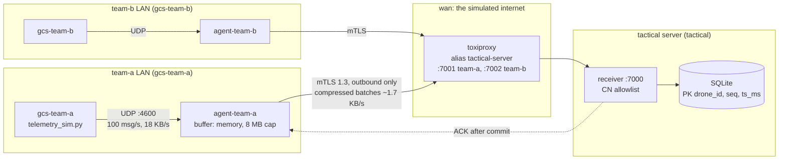

# Secure telemetry pipeline over unreliable connections

Forwards drone telemetry from each team's instance to a tactical server over mutual TLS,
through a link that drops, slows down and narrows.



Every box is a container. The team LANs, `wan` and `tactical` are internal Docker
networks with no way out. The receiver publishes no port, so the only way in is through
Toxiproxy, and the only port on the host is the Toxiproxy API on `127.0.0.1:8474`.

## Running it

Needs Docker with Compose v2, `make`, `python3` (3.10+) and `curl`. The step CLI is
optional: `scripts/certs.sh` falls back to the `smallstep/step-cli` image.

```sh
make up              # generate config, create certificates, start everything
make status          # 6 containers running
make test-delivery   # every team in teams.txt has data on the tactical server
make test-rogue      # unknown instances are rejected
make report          # per drone: stored, missing, delivery delay (last 5 min)
make logs            # follow the receiver and the agents

make short-outage    # 30 s down
make long-outage     # 10 min down
make high-latency    # 5 min of 2000 ms ± 500 ms
make low-bandwidth   # 5 min of 10 KB/s upstream
scripts/scenario.sh short-outage team-a   # one team only; the other is the control
```

Scenarios use the exact API calls from [docs/NETWORK-SCENARIOS.md](docs/NETWORK-SCENARIOS.md)
and save their output to `results/`.

To add a team, append it to `teams.txt` and run `make up`. `make down` stops everything,
`make clean` also deletes stored telemetry (certificates are kept).

## Layout

| Path | |
| ---- | - |
| `teams.txt` | The list of instances. Everything else is derived from it. |
| `pipeline/agent.py` | Instance agent: UDP in, buffer, mTLS out. |
| `pipeline/receiver.py` | Tactical server: mTLS in, validate, store, ack. |
| `pipeline/protocol.py` | Framing, batches and acks. |
| `pipeline/tls.py` | TLS contexts. |
| `pipeline/report.py` | Gaps and delays per drone, used by the tests. |
| `scripts/generate.py` | Writes `docker-compose.yml` and `toxiproxy/toxiproxy.json` from `teams.txt`. |
| `scripts/certs.sh` | CA and per-node certificates. |
| `scripts/*.sh` | Delivery, rogue and network scenario tests. |
| `gcs-sim/` | The provided simulator, unchanged. |

## Part 1: Deployment

`make up` runs three steps, each safe to repeat:

1. `scripts/generate.py` writes the compose file and Toxiproxy config from `teams.txt`.
   The output is deterministic and only written when it changes. Both files are
   committed so they can be reviewed.
2. `scripts/certs.sh` creates the CA and certificates if missing, and re-issues a leaf
   only when it's close to expiry. Keys are `0600` in `certs/`, which is gitignored.
3. `docker compose up -d --remove-orphans` converges to the declared state. A team
   removed from `teams.txt` loses its containers.

A second `make up` changes nothing. Getting there took one fix: my first version ran
`docker compose up --build`, and BuildKit's provenance attestation gives every build a
new image id even for identical code, so Compose restarted the agents each time.
`provenance: false` fixed it on Linux but Docker Desktop ignores it, so now `make` only
rebuilds when a source file changed (`.build-stamp`).

Containers run read-only, non-root, with all capabilities dropped, `no-new-privileges`,
no core dumps, and a memory limit on the agents.

Toxiproxy ports are `7001 + position in teams.txt`, so new teams go at the end.

## Part 2: Security and identity

I went with mutual TLS 1.3 and a private CA (created with `step`):

- One certificate per instance with CN = team id, one for the server with SAN
  `tactical-server`. Each instance has its own key.
- TLS 1.3 only, so forward secrecy: a key stolen later can't decrypt recorded traffic.
- A client gets in only if its certificate is signed by the pipeline CA (otherwise the
  handshake fails) **and** its CN is in the allowlist generated from `teams.txt`. Removing
  a team from `teams.txt` revokes it even though its certificate is still valid.
- The identity is tied to the data: every message must have `team_id` equal to the
  connection's CN and `drone_id` = `<CN>-n`, or it's discarded. A compromised instance
  can only lie about its own team.
- Agents trust only the pipeline CA, not the system store, and check the hostname.
- Toxiproxy is a plain TCP proxy, so TLS runs end to end through it. It has the network
  alias `tactical-server` on `wan`, so agents never know it's there.

Alternatives I considered:

- **WireGuard** would be a good fit, but it's UDP and Toxiproxy only proxies TCP.
  IPsec has the same problem and is heavier to configure.
- **SSH tunnels** encrypt fine, but per-instance key management and letting the server
  know *who* sent the data are awkward, and it's another process to supervise.
- **PSK + HMAC** in the app is hand-rolled crypto with no forward secrecy.
- **A broker** (MQTT, NATS, Kafka) ends up using mTLS for identity anyway, plus a
  heavy component to run.

Weak points: the CA key is an unencrypted file on the deployment host (to keep the demo
non-interactive), there's no CRL/OCSP (the allowlist does that job), and a key on a
captured instance works until the team is removed from `teams.txt`. Leaf certificates
last 90 days.

## Part 3: The pipeline

A small asyncio service in plain Python, standard library only. It runs
on the same base image as the simulator.

### Agent

Three loops, so a slow uplink never slows down reading from the GCS:

1. **Ingest:** the UDP handler only appends the datagram to a list. Receive buffer is
   1 MiB; datagrams over 2 KB are dropped (a real one is ~180 bytes).
2. **Batcher:** every second, the pending messages (~100) become one zlib-compressed
   batch. Costs up to 1 s of latency, makes the data ~10× smaller (18 KB/s → ~1.7 KB/s).
3. **Sender:** one mTLS connection, sends batches oldest first, and only removes a batch
   from memory when the receiver acks it.

### Protocol

Each frame is a 4-byte length plus a body. `BATCH` is an 8-byte id plus the zlib data,
`ACK` is the 8-byte id. Frames are capped at 1 MiB and decompression at 8 MiB, so a
decompression bomb can't take down the receiver.

### Receiver

Per connection: TLS handshake, identity check, then for each batch validate every
message, store it in one SQLite transaction, and only then ack. If the same identity
connects again (common after an outage, when the old connection is half dead) the new
connection wins. There's also a connection limit.

## Part 4: Bad connectivity

### Acks and a window

Under the bandwidth limit a sender can keep writing for minutes before a write blocks,
and an outage drops whatever is sitting in socket buffers. So a successful `write()`
proves nothing, and the agent waits for application-level acks.

- Unacked batches are kept, and go back to the front of the buffer on disconnect.
- At most 64 KB is unacked at a time. Stop-and-wait would mean one batch per round trip
  (~5 s with the latency scenario); with the window 3–5 batches are in flight and
  throughput doesn't suffer.
- If nothing has been acked for 30 s while data is in flight, the agent reconnects. TCP
  alone can take many minutes to notice a dead path, and 30 s is well above the worst
  round trip in the latency scenario.

### Buffer: memory only, 8 MB cap, drop oldest

One team produces ~1.7 KB/s compressed, so 8 MB is about 75 minutes of outage. The
10-minute scenario peaked at 1.09 MB. The cap is `AGENT_BUFFER_MAX_BYTES`.

Why this policy:

- **Unbounded** would eventually run out of memory and crash, losing everything.
- **Blocking** pushes back onto the GCS, which is fire-and-forget UDP, so the kernel
  just drops new datagrams. That's drop-newest, but invisible.
- **Drop newest** keeps the start of the outage and loses what's happening now, which is
  the more useful data.
- **Drop oldest** keeps the most recent window with predictable memory. This is what I
  built.

A good next step would be downsampling old data (50 Hz is far more than needed for
analysis) before dropping it.

### The buffer doesn't survive a restart, on purpose

It's location history. If an instance is captured, everything on its disk is exposed,
and the brief says individual messages are low value but leaking locations is high
risk. Encrypting to disk only helps if the key lives somewhere safe like a TPM; a key on
the same disk is the same as plaintext. So the buffer stays in RAM, and core dumps are
disabled so a crash doesn't write it out either. The cost: a restarted agent loses its
unacked buffer plus what arrives while it's down.

### Reconnecting without a stampede

- Exponential backoff with full jitter: wait a random time in
  `[0, min(30 s, 1 s × 2^attempt)]`, reset once a connection gets an ack. If every team
  loses the link at once, they don't all come back at the same moment.
- The 64 KB window also limits the backlog, so even a full buffer is sent at the pace
  the receiver acks.
- On the receiver: a connection limit, 15 s handshake timeout, 120 s idle timeout.

The trade-off is that a team can take up to 30 s to reconnect after a long outage. In
the 10-minute scenario it took 0–17 s, and the backlog was gone within a few seconds.

### Delivery guarantee

At-least-once with deduplication. A batch is resent until acked, so if an ack gets lost
the batch arrives twice; the primary key `(drone_id, seq, ts_ms)` with
`INSERT OR IGNORE` drops the copy. `ts_ms` is in the key because `seq` restarts at 0
when the simulator restarts.

Data usually arrives in order, but that isn't guaranteed across reconnects and nothing
depends on it. Rows store `ts_ms` (GCS clock) and `received_ms` (server clock), and
consumers sort by `ts_ms`.

Messages are lost only when the cap is hit or the agent restarts, which are the
designed trade-offs.

### Network restrictions

Agents only dial out; they listen on UDP 4600 inside their own team LAN. Nothing is
published from an agent or GCS. The receiver listens on 7000, reachable only from
Toxiproxy on the `tactical` network.

## Part 5: Results

| Check | Command | Expected |
| ----- | ------- | -------- |
| Every instance delivers | `make test-delivery` | `PASS` for every team |
| Unknown instances rejected | `make test-rogue` | 4 × `PASS`: foreign CA, unlisted identity, no certificate, no rogue data stored |

Network scenarios, run on Docker Desktop (macOS) against both teams at once. Full
output is in `results/`.

| Scenario | Lost | Duplicates | Reconnected after restore | Delay p50 / max | Buffer peak |
| -------- | ---- | ---------- | ------------------------- | --------------- | ----------- |
| Baseline | 0 | 0 | – | 0.5 s / 1.0 s | 0 |
| Short outage, 30 s | 0 | 0 | 6–15 s | 12–20 s / 37–45 s | 52–70 KB |
| Long outage, 10 min | 0 | 0 | 0–17 s | 291–309 s / 601–619 s | 1.09 MB |
| High latency, 2 s ± 0.5 s | 0 | 0 | no disconnect | 2.5 s / 3.5 s | 0 |
| Low bandwidth, 10 KB/s | 0 | 0 | no disconnect | 0.7 s / 1.3 s | 0 |

The outage delays are the buffer working: a message from the first second of a
10-minute outage is delivered ~10 minutes late.

I also checked the designed losses by hand:

- **Cap:** with a 20 KB cap and a 30 s outage, the receiver got the last ~11 s of the
  outage and was missing the first ~44 s. Memory stayed under the cap.
- **Agent restart:** about 2 s of data lost (the buffer plus what arrived while down).

## What I'd do with more time

1. Unit tests for the buffer (cap, requeue order) and protocol (bad frames,
   decompression bomb), and run the scenario scripts in CI.
2. Downsample old data before dropping it.
3. Prometheus metrics instead of log lines (buffer size, oldest age, drops, reconnects),
   and an alert when a team goes silent.
4. On SIGTERM, give the sender a few seconds to flush the buffer.
5. Load-test the receiver with many instances reconnecting at once with full buffers.

For production:

- Keep the root CA offline, issue short-lived certificates (hours) from `step-ca` with
  automatic renewal, and generate each instance's key on the device, ideally in a TPM.
- Pin the allowlist on certificate fingerprints, not only CNs.
- Deploy with Ansible, agent under systemd or `restart: always`, firewall instances to
  outbound only.
- TimescaleDB instead of SQLite, and an encrypted disk on the tactical server since it
  holds every team's locations.
