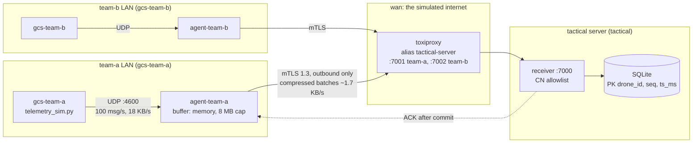

# Secure telemetry pipeline over unreliable connections

Forwards drone telemetry from each team's instance to a tactical server, encrypted and
authenticated with mutual TLS, over a link that drops, slows down and narrows.



Each box is a container. Each team LAN, `wan` and `tactical` are internal Docker networks:
they have no access outside the deployment. The receiver publishes no port, so the only
way in is through Toxiproxy. The only port on the host is the Toxiproxy API, on
`127.0.0.1:8474`.

## Contents

- [Running it](#running-it)
- [Repository layout](#repository-layout)
- [Part 2: Security and identity](#part-2-security-and-identity)
- [Part 3: The pipeline](#part-3-the-pipeline)
- [Part 4: Bad connectivity](#part-4-bad-connectivity)
- [Part 5: Proof it works](#part-5-proof-it-works)
- [Part 1: Deployment and idempotency](#part-1-deployment-and-idempotency)
- [What I would change for production](#what-i-would-change-for-production)
- [What I would do next](#what-i-would-do-next)

## Running it

Needs Docker with Compose v2, `make`, `python3` (3.10+, stdlib only) and `curl`. Tested on
macOS and Linux. No step CLI is needed: `scripts/certs.sh` uses the `smallstep/step-cli`
image when `step` is not installed.

```sh
make up              # generate config, create certificates, start everything
make status          # 6 containers running
make test-delivery   # every team in teams.txt has data on the tactical server
make test-rogue      # three kinds of unknown instance are rejected
make report          # per drone: stored, missing, delivery delay, last 5 minutes
make logs            # follow the receiver and the agents
```

The network scenarios from [docs/NETWORK-SCENARIOS.md](docs/NETWORK-SCENARIOS.md), each
run on every team's proxy and saved to `results/<scenario>.txt`:

```sh
make short-outage    #  30 s down
make long-outage     #  10 min down
make high-latency    #   5 min of 2000 ms ± 500 ms both ways
make low-bandwidth   #   5 min of 10 KB/s upstream
scripts/scenario.sh short-outage team-a   # only one team, the other is the control
```

To add a team, append its id to `teams.txt` and run `make up`. `make down` stops
everything; `make clean` also deletes the stored telemetry (certificates are kept).

## Repository layout

| Path | What it is |
| ---- | ---------- |
| `teams.txt` | The only list of instances. Everything below is derived from it. |
| `pipeline/agent.py` | Instance agent: UDP in, buffer, mTLS out. |
| `pipeline/receiver.py` | Tactical-server receiver: mTLS in, validate, store, ack. |
| `pipeline/protocol.py` | Framing, batches and acks shared by both. |
| `pipeline/tls.py` | The TLS contexts. |
| `pipeline/report.py` | Gaps and delays per drone, for the proofs. |
| `scripts/generate.py` | Writes `docker-compose.yml` and `toxiproxy/toxiproxy.json` from `teams.txt`. |
| `scripts/certs.sh` | Creates the CA and per-node certificates with step. |
| `scripts/scenario.sh`, `test-*.sh` | Part 5 proofs. |
| `gcs-sim/` | The provided simulator, unchanged. |

## Part 2: Security and identity

### Choice: mutual TLS 1.3 with a private CA

- The pipeline has its own CA, created with `step`. It signs one certificate per
  instance, with CN = team id, and one for the server, with SAN `tactical-server`.
- **Encrypted in transit:** TLS 1.3 only. It has forward secrecy, so a key stolen later
  does not decrypt recorded traffic.
- **Each instance has its own identity:** its own key pair and certificate. The key
  never leaves the instance.
- **Only known instances are accepted.** A client must pass two checks:
  1. Its certificate is signed by the pipeline CA. Anything else fails the TLS
     handshake: no certificate (`PEER_DID_NOT_RETURN_A_CERTIFICATE`) or a certificate
     from another CA (`CERTIFICATE_VERIFY_FAILED`).
  2. Its CN is in the allowlist, which is generated from `teams.txt`. This makes
     revocation easy: remove a team from `teams.txt`, run `make up`, and its still-valid
     certificate is refused.
- **The identity is bound to the data:** every message in a batch must have
  `team_id` = the CN of the connection, and `drone_id` = `<CN>-n`. Otherwise the message
  is discarded. A compromised instance can only lie about its own team, not inject data
  as another team.
- **The server is authenticated too:** agents trust only the pipeline CA (not the system
  store) and check the hostname. A man in the middle with a public certificate is
  rejected.
- **Toxiproxy and the server name:** Toxiproxy is a plain TCP proxy, so TLS runs end to
  end through it. On the `wan` network it has the alias `tactical-server`, the name the
  server certificate is issued for. Agents dial `tactical-server:700x` and never know a
  proxy is in between. In a real deployment the name is the tactical server's DNS name.

### Alternatives considered

| Option | Why not |
| ------ | ------- |
| WireGuard | Runs over UDP, which Toxiproxy cannot proxy. Otherwise a strong fit: simple keys, built-in roaming. |
| IPsec | Also UDP (IKE, ESP) and heavy to configure. |
| SSH tunnel per instance | Encrypts and authenticates, but managing keys per instance, and having the server learn *who* sent the data, is awkward. Also adds a second process to supervise. |
| Pre-shared key + HMAC in the application | Hand-rolled crypto, no forward secrecy, a shared secret per team to distribute. |
| A broker with TLS (MQTT, NATS, Kafka) | Solves the same identity problem with mTLS anyway, plus a heavy component to run. See Part 3. |

**mTLS trade-offs, honestly:**

- The CA key is the crown jewel. Here it is an unencrypted file on the deployment host,
  to keep the demo non-interactive.
- Certificates expire: leaves last 90 days, and `certs.sh` re-issues them when
  `step certificate needs-renewal` says so.
- There is no CRL/OCSP; the allowlist plays that role.
- A private key on an instance that is captured is usable until the team is removed from
  the allowlist. See [production](#what-i-would-change-for-production).

## Part 3: The pipeline

### Tooling: a small asyncio service in plain Python, no dependencies

I considered **Vector** and **Fluent Bit**, which are self-hosted shippers with UDP input,
TLS and buffers. Their buffers fit this brief badly in two ways:

- Disk buffers write location history to the instance in plaintext.
- They don't give me the drop-oldest, byte-capped, memory-only behavior I wanted.

I also considered **brokers** (NATS JetStream, Kafka, MQTT with persistence). They add a
stateful server to run, and they don't remove the need for an agent at the edge.

The pipeline is about 600 lines of commented Python on the standard library only (`asyncio`,
`ssl`, `zlib`, `sqlite3`). It runs in the same base image as the provided simulator, and
every behavior the assignment grades is explicit in code I can explain line by line.

**Trade-off:** I own the protocol, so I own its bugs. With more time or more teams I would
move the receiver's storage to a time-series database, and keep the agent.

### The agent: three loops, decoupled

1. **Ingest:** the UDP handler only appends the datagram to a list. No parsing, no I/O,
   no locks, so nothing on the uplink can slow down reading the GCS. The receive buffer
   is raised to 1 MiB. Datagrams over 2 KB are dropped, since a valid one is ~180 bytes.
2. **Batcher:** every 1 s, the collected messages (~100) become one zlib-compressed batch
   in the buffer. This adds at most 1 s of delay. In return the data is **~10× smaller**
   (measured: 18 KB/s becomes ~1.7 KB/s), and TLS and framing overhead per message
   becomes negligible.
3. **Sender:** keeps one mTLS connection and sends batches oldest first. A batch leaves
   memory only when the receiver **acks** it.

### Wire protocol

Inside TLS, each frame is a 4-byte length plus a body:

- `BATCH`: an 8-byte batch id plus the zlib data (agent to receiver).
- `ACK`: the 8-byte batch id (receiver to agent).

Frames are capped at 1 MiB and decompression at 8 MiB, which protects the receiver from
decompression bombs.

### The receiver

For each connection:

1. TLS handshake.
2. Identity check.
3. For each batch: validate every message (types, ranges, `team_id` = CN).
4. Store the batch in **one SQLite transaction**.
5. **Then** ack. Acking after the commit is what makes an acked batch durable.

If an identity connects again while its old connection still looks alive, which is common
after an outage, the newest connection wins. There is also a connection limit
(`RECEIVER_MAX_CONNECTIONS`).

## Part 4: Bad connectivity

### Why application acks, and a window

NETWORK-SCENARIOS.md notes that under the bandwidth limit "a sender can keep writing for
minutes before a write blocks", and Toxiproxy drops connections instantly on an outage.
So a successful `write()` proves nothing, and anything in socket buffers or in the proxy
when the link drops is gone.

- **Acks:** the agent keeps every unacked batch. On disconnect, unacked batches go back
  to the front of the buffer, in order.
- **Window (64 KB of unacked data):** limits how much is in limbo at once, without
  stop-and-wait. Stop-and-wait would cap throughput at one batch per round trip, about
  5 s in the latency scenario. With the window, 3–4 batches are in flight there, and
  throughput is unaffected.
- **Watchdog:** if data is in flight and nothing has been acked for 30 s, the agent drops
  the connection and reconnects. TCP alone can take many minutes to notice a dead path.
  30 s is well above the ~5 s worst-case round trip of the latency scenario, so a slow
  link is never mistaken for a dead one.

### Buffer size: what I chose and why

**Chosen: memory only, a hard cap in bytes (default 8 MB), drop oldest.**

Sizing: one team produces ~1.7 KB/s compressed, so 8 MB holds **~75 minutes** of outage.
The 10-minute scenario peaked at 1.08 MB. The cap is `AGENT_BUFFER_MAX_BYTES`. It is
counted in compressed bytes because memory is the real limit.

The brief's priorities are: individual messages have low value, the GCS must not be
affected, and leaking locations is high risk. They rule out most options:

| Strategy | Consequence | Verdict |
| -------- | ----------- | ------- |
| Unbounded | A long outage exhausts memory, the agent crashes and *everything* is lost. Worst failure mode. | No |
| Block when full | Backpressure ends at the GCS, which is fire-and-forget UDP: the kernel silently drops new datagrams. Same as drop-newest, but less visible. | No |
| Drop newest | Keeps the start of the outage, loses what is happening now. Fresh data is worth more for jamming bubbles and fleet state. | No |
| **Drop oldest** | Keeps the most recent window; loses the start of a very long outage. Memory is bounded and predictable. | **Yes** |
| Downsample old data (e.g. keep 1 in 10 beyond N minutes) | Covers longer outages at lower resolution. 50 Hz is far more than flight-behavior analysis needs. | Good next step, not built |
| Time-to-live (drop data older than X) | Useful if old data is worthless. Byte caps bound memory directly, TTL does not. | Can be combined |

### Does buffered data survive an agent or instance restart? No, on purpose.

The buffer holds location history. If an instance in the field is captured, everything on
its disk is exposed. Writing the buffer to disk trades confidentiality (high risk) for
delivery of data the brief calls low value. The options, in order of exposure:

| Option | Survives restart | Exposure if the instance is captured |
| ------ | ---------------- | ------------------------------------ |
| **Memory only (chosen)** | No | Only what is in RAM at that moment. Core dumps are disabled (`ulimit core 0`), so a crash does not write it out either. |
| Disk, encrypted with a key held only in memory | No: the key dies with the process | None at rest, but no benefit over memory either. Only useful to keep RAM low for very large buffers. |
| Disk, encrypted with a key in a TPM or HSM | Yes | Low, if the key cannot be extracted. Needs hardware support. |
| Disk, encrypted with a key on the same disk | Yes | Same as plaintext: an attacker has both. |
| Disk, plaintext (what Vector or Fluent Bit disk buffers do) | Yes | The full location history. |

The cost is measured (see Part 5): an agent restart loses its unacked buffer, plus the
datagrams that arrive while it is down (~100/s).

### Reconnecting without overloading the tactical server

- **Exponential backoff with full jitter:** wait a random time in
  `[0, min(30 s, 1 s × 2^attempt)]`, and reset after a connection gets at least one ack.
  Instances that lost the link at the same moment, as all teams do in an outage of the
  server's own link, spread their reconnects instead of arriving together.
- **Backlog sent in limited windows:** each agent has at most 64 KB unacked, so even a full
  8 MB buffer reaches the receiver at the receiver's own pace. The receiver controls the
  rate by how fast it acks.
- **On the receiver:** a connection limit, a 15 s handshake timeout, and a 120 s idle
  timeout. An unlisted identity is refused, and its agent keeps backing off.

**Trade-off:** after a long outage, a team may reconnect up to 30 s after the link is back.
In the 10-minute scenario it took 17–19 s, and the backlog was then sent within 7 s.

### Delivery guarantee: at-least-once, deduplicated, so effectively once

- **At-least-once:** a batch is resent until it is acked. Duplicates are expected when an
  ack is lost: the batch was stored, but the ack never reached the agent.
- **Duplicates:** the primary key `(drone_id, seq, ts_ms)` with `INSERT OR IGNORE`
  discards a resent message. `ts_ms` is in the key because `seq` restarts at 0 when the
  simulator restarts, so `seq` alone would collide with old data.
- **Ordering:** each connection delivers in order, and requeued batches go back in
  front. So in practice data is stored in order, but this is **not guaranteed across
  reconnects**, and nothing depends on it. The receiver stores `ts_ms` (GCS clock) and
  `received_ms` (server clock). Consumers order by `ts_ms`. A late batch, or one with a
  skewed GCS clock, does not corrupt anything.
- **Not exactly-once:** messages are lost when the cap is hit or the agent restarts,
  because these are the designed trade-offs. Within those limits, nothing acked is lost
  and nothing is stored twice.

### Network restrictions

- **Instances only make outbound connections:** agents dial out and listen only on UDP
  4600 inside their team's LAN. No port is published from an agent or a GCS container.
- **The tactical server exposes only what the pipeline needs:** the receiver listens on
  7000, reachable only through Toxiproxy on the `tactical` network. Toxiproxy exposes one
  port per team on `wan`. The Toxiproxy API is the only port on the host, on localhost,
  and it stands in for the internet, so it is not part of the server.

## Part 5: Proof it works

Each script prints its result and saves it to `results/`.

| Check | How | Expected |
| ----- | --- | -------- |
| Every instance delivers | `make test-delivery` | `PASS` for every team in `teams.txt` |
| Unknown instances are rejected | `make test-rogue` | 4 × `PASS`: foreign CA, identity not allowed, no certificate, no rogue data stored |
| Network scenarios | `make <scenario>` | See below |

### Measured results

These runs used the same code, real Toxiproxy 2.12.0 and the exact API calls from
NETWORK-SCENARIOS.md. They ran as local processes on Linux, 2 teams, both drones each.
The Docker runs write their own numbers to `results/`.

Measured with Docker Desktop on macOS, the exact API calls from NETWORK-SCENARIOS.md,
applied to both teams at once. The full output of each run is in `results/`.

| Scenario | Lost | Duplicates | Reconnects | Delivery delay (p50 / max) | Agent buffer peak |
| -------- | ---- | ---------- | ---------- | -------------------------- | ----------------- |
| Baseline | 0 | 0 | 0 | 0.5 s / 1.0 s | 0 |
| Short outage, 30 s | 0 | 0 | after restore, 6–15 s later | 12–20 s / 37–45 s | 52–70 KB |
| Long outage, 10 min | 0 | 0 | after restore, 0–17 s later | 291–309 s / 601–619 s | 1.09 MB of 8 MB |
| High latency, 2 s ± 0.5 s | 0 | 0 | 0 | 2.5 s / 3.5 s | 0 (3–5 batches in flight) |
| Low bandwidth, 10 KB/s | 0 | 0 | 0 | 0.7 s / 1.3 s | 0 (needs ~1.7 KB/s) |

How to read the outage delays: data built during the outage arrives after it. A message
from the first second of a 10-minute outage is ~10 minutes late. That is the buffer
doing its job, not a slow link.

Two more checks, run on purpose to show the designed losses:

- **Cap (drop oldest):** a 20 KB cap and a 30 s outage. The receiver had the *last* ~11 s
  of the outage and was missing the first ~44 s, exactly as designed. Memory stayed under
  the cap the whole time.
- **Agent restart:** about 2 s of data was lost: the in-memory buffer, plus what arrived
  while the agent was down. This is the cost of not persisting location history.

## Part 1: Deployment and idempotency

`make up` runs three steps, each idempotent:

1. `scripts/generate.py`: writes `docker-compose.yml` and `toxiproxy/toxiproxy.json`
   from `teams.txt`. The output is deterministic, and files are rewritten only when their
   content changes. Both generated files are committed, so they can be reviewed, and say
   at the top that they are generated.
2. `scripts/certs.sh`: creates the CA and certificates only if they don't exist. A leaf
   certificate is re-issued only when it is close to expiry. Keys are `0600` in a `0700`
   directory, and everything lives in `certs/`, which is gitignored.
3. `docker compose up -d --remove-orphans`: Compose converges to the declared
   state. Unchanged containers are left running, and a team removed from `teams.txt`
   loses its containers.

Running `make up` a second time changes nothing: no files written, no certificates
issued, no containers recreated.

The first version did recreate every built container on the second run. It called
`docker compose up --build`, and BuildKit attaches a provenance attestation with build
metadata to each image, so identical code got a new image id on every build. Compose saw
a "new" image and restarted the agents, which cost a few seconds of telemetry.
`provenance: false` fixed it on Linux but is ignored by Docker Desktop's builder. The
fix that holds everywhere: `make` rebuilds the images only when one of their source files
changed (`.build-stamp`), and `up` itself never builds.

Containers are hardened: read-only root filesystem, all capabilities dropped,
`no-new-privileges`, non-root user, no core dumps, and a memory limit on the agents.

**Toxiproxy ports** are `7001 + position in teams.txt`, so new teams are appended at
the end. With Ansible or Kubernetes, each instance would get its own fixed address
instead.

## What I would change for production

- **CA and keys:**
  - Keep the root CA offline. Issue from an intermediate in `step-ca`, with short-lived
    certificates (hours) renewed automatically over ACME or `step ca renew`.
  - Generate each instance's key on the instance, in a TPM if it has one, so the
    private key never leaves the device.
- **Revocation:** short-lived certificates instead of CRLs, plus the allowlist for
  immediate removal. Pin the allowlist on certificate fingerprints as well as CNs.
- **Real nodes:** deploy the same images with Ansible, one instance per host. Run the
  agent under systemd, or as a container with `restart: always`. Firewall: instances
  outbound only, and the server inbound only on the pipeline port.
- **Storage:** TimescaleDB or similar instead of SQLite. Encrypt the tactical server's
  disk too, since it holds every team's locations.
- **Observability:** Prometheus metrics instead of log lines: buffer bytes, oldest age,
  drops, reconnects, acks per second, duplicates. Alert when a team has been silent
  for X minutes.
- **Downsampling** as the second stage of the buffer policy, to cover longer outages.
- **Graceful shutdown:** on SIGTERM, give the sender a few seconds to send the buffer.
- **Tests:** unit tests for `Buffer`, `protocol` and `parse`, and the scenario scripts
  in CI.

## What I would do next

In this time box I prioritized a correct, explainable core and real proof of the four
scenarios. Next, in order:

1. Unit tests for the buffer (cap, requeue order) and the protocol (bad frames,
   decompression bomb).
2. Downsampling before dropping.
3. Metrics endpoint.
4. A receiver load test: many instances reconnecting at once with full buffers.
